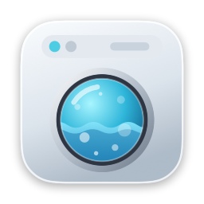
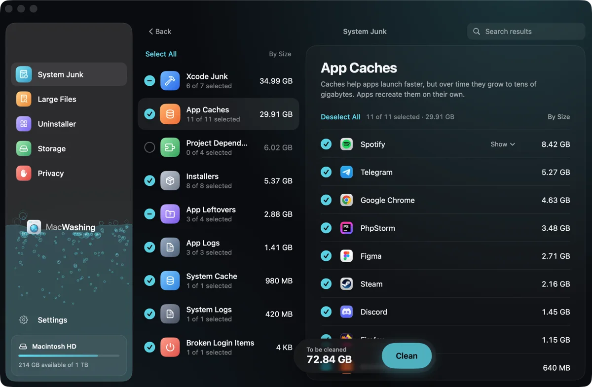
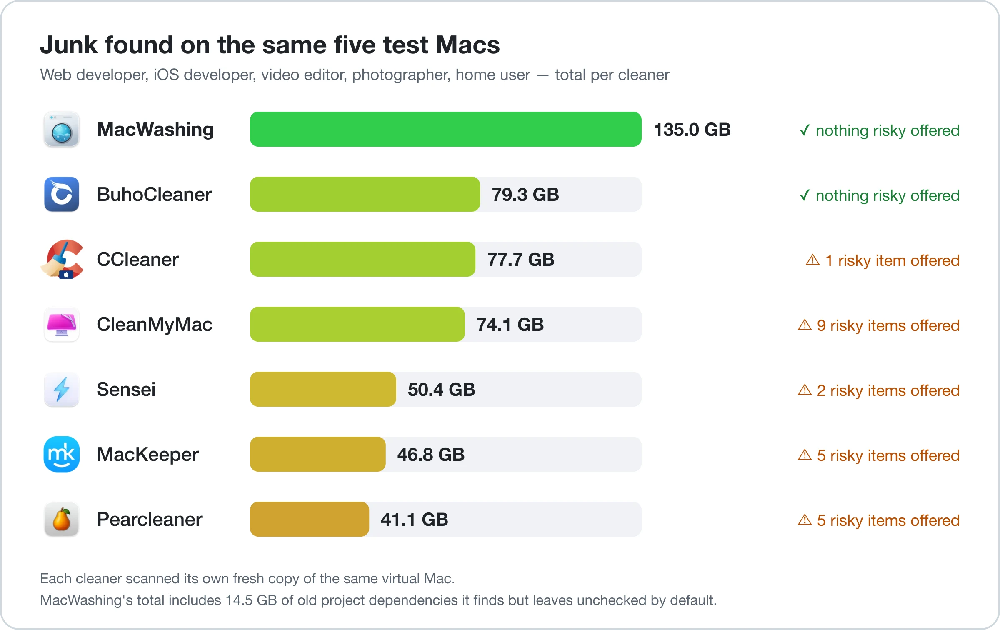
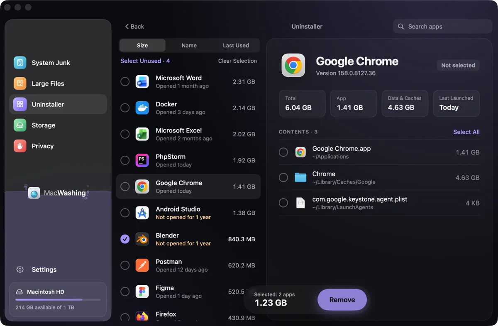
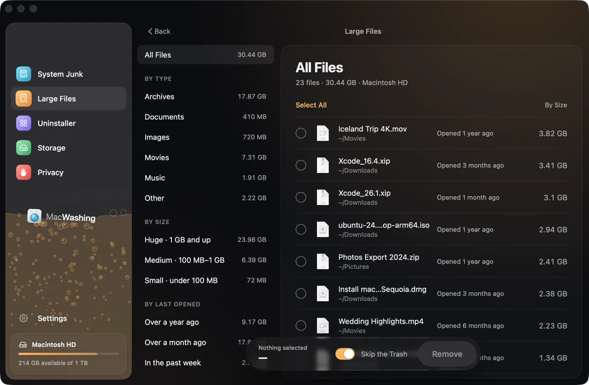
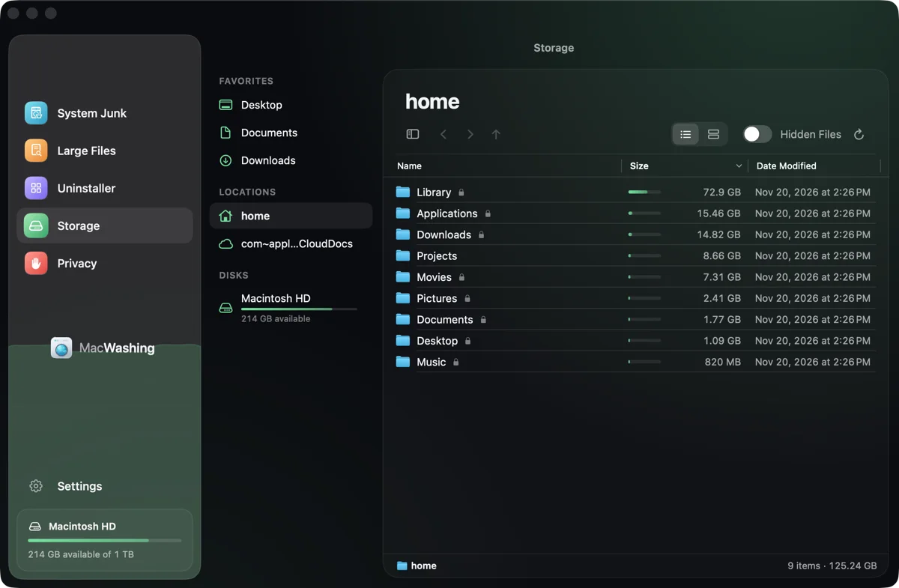
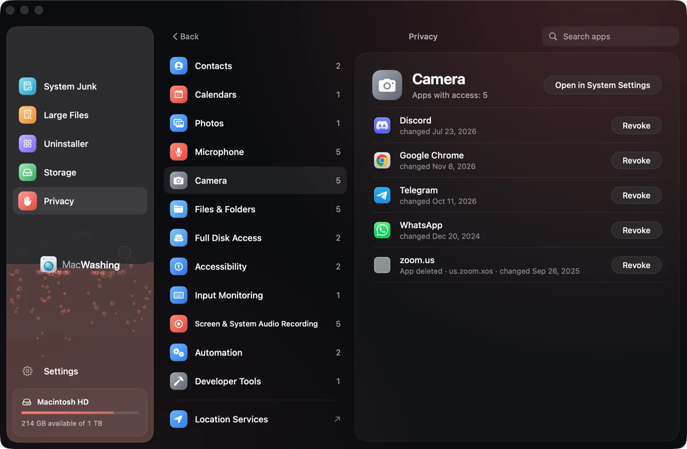

<p align="center">
  
</p>

<h1 align="center">MacWashing</h1>

<p align="center">
  <b>A careful Mac cleaner and uninstaller. Free and open source.</b><br>
  An open rules database and a modern approach that leaves the paid cleaners far behind.
</p>

<p align="center">
  <a href="https://github.com/in4in-dev/macwashing/releases/latest/download/MacWashing.dmg"><b>⬇︎ Download MacWashing for Mac</b></a>
  &nbsp;·&nbsp; macOS 14 Sonoma or later &nbsp;·&nbsp; Apple silicon and Intel
  <br>
  <a href="https://in4in-dev.github.io/macwashing/">Website</a> ·
  <a href="CHANGELOG.md">What’s new</a> ·
  <a href="https://in4in-dev.github.io/macwashing/apps/">Apps in the database</a>
</p>

<p align="center">
  
</p>

## What makes it different

More than 900 apps were installed one by one on a clean macOS virtual machine (several macOS versions). Each of them
was actually used for what it is made for, and then an AI assistant analyzed in detail where — and, above all, with
what — these apps clutter the disk.

That is how the MacWashing database was built. Then it was checked. And checked again. And checked once more: what
matters most is that cleaning never touches files that are important to you.

The list turned out to be very long. That is why MacWashing showed such remarkable results:

<p align="center">
  
</p>

## What it can do

- **System Junk** — finds service junk and caches of installed and removed apps and offers to remove them. Above all,
  everything that piles up while you work in photo and video editors, IDEs, 3D modeling, design and engineering apps.
- **Uninstaller** — removes apps without leaving junk behind. It doesn’t touch your own data (chats, libraries,
  backups) unless you explicitly ask it to.
- **Large Files** — shows which files take up the most space on the disks and folders you choose.
- **Storage** — Finder the way it should be: the size of every folder and file, right away.
- **Privacy** — quickly check which apps have which permissions. Taking one back is a single click.
- **Auto-Clean** — remembers what you chose when cleaning and repeats it on the schedule you set.
- 12 interface languages. No account, no limits, nothing sent anywhere: scanning works without the internet.

| Uninstaller | Large Files |
|---|---|
|  |  |
| **Storage** | **Privacy** |
|  |  |

## Safety

Every path MacWashing offers to remove has been checked individually. It never touches what may be precious to you.

## Install

1. [Download `MacWashing.dmg`](https://github.com/in4in-dev/macwashing/releases/latest/download/MacWashing.dmg) (signed
   with a Developer ID and notarized by Apple) and drag MacWashing to Applications.
2. On the first launch, give it **Full Disk Access** when it asks: macOS hides caches, logs and the permissions
   database from apps without it. MacWashing shows exactly which switch to turn on.
3. For system folders it asks to approve its helper in System Settings ▸ General ▸ Login Items.

MacWashing updates itself through [Sparkle](https://sparkle-project.org): it checks this repository once a day. A newer
rules database arrives between app releases on its own and works from the next launch. Both are signed, and the app
checks the signatures before using anything.

## Build from source

You need Xcode 26 and [XcodeGen](https://github.com/yonaskolb/XcodeGen) (`brew install xcodegen`).

```bash
git clone https://github.com/in4in-dev/macwashing.git
cd MacWashing
xcodegen
open MacWashing.xcodeproj
```

Set your own team in `project.yml` (`DEVELOPMENT_TEAM`) and in `HelperConstants.teamID` and the requirements next to it
(`Packages/MacWashingKit/Sources/MacWashingXPC/HelperProtocol.swift`): the app and its helper only talk to code signed
by that team.

**Debug builds never delete anything** (a “DevMode” badge says so): every removal is a dry run unless you launch with
`MW_REAL_DELETE=1`. `MW_FAKE_HOME=<folder>` (and `MW_FAKE_ROOT`) makes the app scan a made-up home instead of yours —
that is what the UI tests do.

Tests:

```bash
swift test --package-path Packages/MacWashingKit
```

The UI tests (`App/UITests`, scheme MacWashing) drive the real app with XCUITest and take over the screen and keyboard
while they run: run them in a virtual machine or on a Mac you don’t need for a while.

## Repository layout

| Path | What |
|---|---|
| `App/` | The app: SwiftUI sources, resources (the rules database, string catalogs), UI tests |
| `Helper/` | The privileged helper (XPC, `SMAppService`) that removes what needs root |
| `Packages/MacWashingKit/` | Scanners, cleaning, the rules database, the uninstaller, policies; the helper protocol (`MacWashingXPC`) |
| `Tools/` | `SignRules` (signs rules database manifests), `JunkDump` (prints a System Junk scan as JSON) |
| `Scripts/release/` | Building the DMG, publishing app releases and rules databases, signing keys |
| `Scripts/site/` | The project page (`site/`, published to GitHub Pages) |
| `updates/` | What installed apps read: `appcast.xml` and newer rules databases (made by the release scripts on the first release) |
| `release-notes/` | “What’s new” of every version, English and Russian |

## Contributing

Issues and pull requests are welcome. For the rules database, an issue with the app, its version and the paths it
leaves behind (and how you know: an uninstall guide of the vendor, a Homebrew `zap`, a check on a clean Mac) is the
best start. A rule that might remove the user’s own files is never added without proof that it is safe.

## Releases (maintainers)

1. `Scripts/release/setup-keys.sh` once: the Sparkle and rules signing keys into the login keychain.
2. App: raise `MARKETING_VERSION` and `CURRENT_PROJECT_VERSION` in `project.yml`, write `release-notes/<version>.en.md`
   and `.ru.md`, then `Scripts/release/build-dmg.sh` and `Scripts/release/publish-release.sh`.
3. Rules database: raise `info.version` in `App/Resources/database.sqlite`, then `Scripts/release/publish-rules.sh` (it
   also rebuilds the project page and the list of apps with the new numbers).
4. Optional: `Scripts/release/virustotal.sh <dmg>` checks a DMG on VirusTotal before publishing;
   `Scripts/release/hooks/install.sh` adds a pre-push reminder when the rules database in `main` is newer than the
   published one; `Scripts/release/homebrew/macwashing.rb` is a template for a Homebrew cask.

## License

MacWashing is free software under the [GNU General Public License v3.0](LICENSE). It uses
[Sparkle](https://github.com/sparkle-project/Sparkle) (MIT) for updates.
